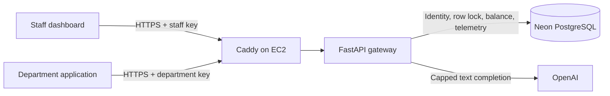

# AI Agent Gateway

A departmental AI usage gateway: give each team a token budget, route text requests through a shared API, and see usage, estimated costs, and failures in one staff dashboard.

**Hosted pilot:** https://dhruvaigateway.duckdns.org — staff access required. This is an operator demo, not an anonymous public playground. No shared credentials are published.

## The problem

When teams experiment with AI independently, administrators need to answer three questions: who is using it, what does it cost, and when should a request stop? This project connects a department's API identity to its allocation, request history, and estimated spend.

The initial user is an internal AI platform administrator supporting teams such as Marketing, Research, and Support. The pilot tests the workflow; it does not yet establish customer adoption or measured business savings.

## What works

- Create departments and issue separate API keys; edit allocations while preserving recorded usage.
- Check prompt headroom before dispatch, limit generated tokens, and charge returned usage.
- Serialize requests and budget edits for the same department using PostgreSQL row locks.
- View daily token usage, department filters, and 7/30-day history in Eastern Time.
- Record successful, blocked, provider-error, and recording-error attempts with latency.
- Estimate standard text costs from input/output/cached token breakdowns and retain the pricing snapshot. Missing historical breakdowns remain explicitly unpriced.
- Deploy on EC2 with Docker, Neon PostgreSQL, and Caddy HTTPS.

## Architecture



See [architecture and tradeoffs](docs/ARCHITECTURE.md), [operator setup](docs/DEPLOYMENT.md), [demo script](docs/DEMO.md), and [dashboard details](DASHBOARD.md).

## Run locally

Use a separate development database; pointing local and hosted apps at the same Neon database means both change the same departments and balances.

```bash
python3 -m venv venv
source venv/bin/activate
pip install -r requirements.txt
cp .env.example .env
```

Set `DATABASE_URL` to a PostgreSQL SQLAlchemy URL using the `postgresql+psycopg` driver, `OPENAI_API_KEY` to your provider key, and `ADMIN_API_KEY` to a separate random staff secret. Generate a staff secret with `python3 -c 'import secrets; print(secrets.token_urlsafe(32))'`. Keep credentials out of Git.

```bash
python -c 'from database import init_db; init_db()'
uvicorn main:app --reload
```

Open http://127.0.0.1:8000 and unlock with the staff key. Create a department and save its API key. Interactive API documentation is at `/docs`.

The chat request body is:

```json
{
  "model": "gpt-4o-mini",
  "prompt": "Classify this ticket: I was charged twice.",
  "max_completion_tokens": 128
}
```

Send it to `POST /v1/chat` with `Authorization: Bearer <department-key>`. Staff keys authorize `/api/admin/*`, not department calls. Real chat requests incur provider charges.

Supported request models: `gpt-4o-mini` and `gpt-4o-mini-2024-07-18`. Responses include `tokens_used`, `remaining_budget`, `completion_token_limit`, `finish_reason`, estimated cost availability, and latency. HTTP 403 means insufficient budget; 422 indicates invalid request fields.

## Validation

```bash
python -m unittest discover -s tests -v
python -m unittest discover -s ops -p 'test_*.py' -v
```

The operations suite has four additional tests for DNS updates and secret-safe failure handling.

Default application run: 29 tests pass and the opt-in PostgreSQL test is skipped. Mocked model responses avoid provider charges. To exercise row locking, set `GATEWAY_TEST_POSTGRES_URL` to a **disposable PostgreSQL database** and rerun. That test creates and removes a unique schema.

Evidence from the November 5, 2026 pilot:

| Check | Observed result | Scope |
| --- | --- | --- |
| Full suite with isolated PostgreSQL 16 | 30 passed | Local; lock wait directly observed through `pg_blocking_pids` |
| EC2 image tests | 29 passed, 1 skipped | Container dependencies and application tests |
| Deployed concurrent requests | One 200 using 37 tokens, one 403; 100 → 63 balance | AWS + Neon + real provider, one two-request trial |
| HTTPS and public port restriction | HTTPS loaded; direct public port 8000 inaccessible | User-verified deployment |

The deployed trial is evidence of expected behavior, not a load benchmark or proof across all failure modes.

## Limits and next decisions

- Shared staff secret; no individual staff accounts, RBAC, or staff-action audit trail. Department API keys are currently stored in plaintext in the database.
- Conservative prompt allowance is UTF-8 bytes plus 64 framing tokens, not exact tokenization. It can reject requests that would fit. Output defaults to 1,024 tokens and is reduced to fit budget/context headroom.
- One in-flight provider request per department trades throughput for simple accounting. The database transaction stays open during the model call.
- Provider calls have no automatic retries and a 30-second SDK timeout. Timeouts, crashes, or database failures can leave provider charges unrecorded. No durable reservations or reconciliation worker yet.
- No automatic monthly budget reset, rate limiting, streaming, tools, retrieval, or multi-provider routing. This is an AI access/accounting gateway, not an autonomous agent runtime.
- Costs are estimates, not invoices. Only configured model/tier rates are priced. Historical unpriced records remain visible.
- Dependencies are currently unpinned. Reproducible lockfiles and CI are follow-up work before broader rollout.

Next product validation: observe an administrator onboarding two teams, measure time to issue a key, and test whether budget-block explanations help users recover. Candidate technical work: scoped staff accounts, hashed/revocable keys, billing reconciliation, and load testing.
